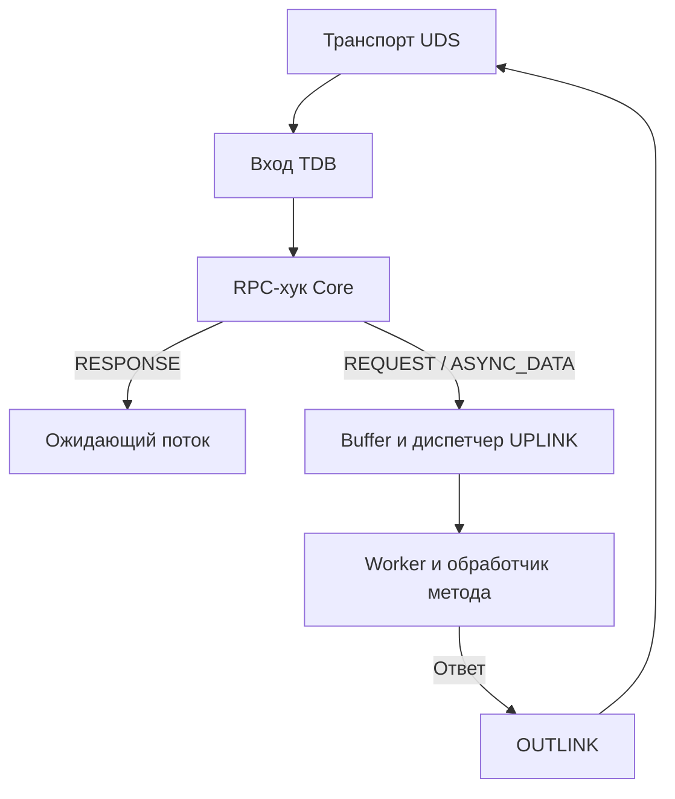

# Loom

**Библиотека для построения приложений из независимых модулей-процессов, взаимодействующих через C-ABI.**

<p>
  
  
  
  
  
</p>

> ⚠️ **Проект в активной разработке.** Публичный API может меняться.

---

## 📖 Содержание

<details>
<summary>Развернуть</summary>

- [Назначение](#-назначение)
- [Прогресс разработки](#-прогресс-разработки)
- [Примеры использования](#-примеры-использования)
- [Архитектура](#-архитектура)
- [Компоненты](#-компоненты)
  - [GWP — Wire Protocol](#-gwp--wire-protocol)
  - [RPC — запрос и ответ](#rpc--запрос-и-ответ)
  - [TDB — Task Distribution Block](#-tdb--task-distribution-block)
  - [Brutal Tester](#-brutal-tester)
- [Установка](#-установка)
- [Кроссязычность](#-кроссязычность)
- [Roadmap](#-roadmap)
- [Принципы](#-принципы)
- [Лицензия](#-лицензия)

</details>

---

## 🎯 Назначение

**Loom** — это библиотека для построения приложений, состоящих из изолированных модулей-процессов. Каждый модуль:

- 🧩 Работает в **собственном процессе**
- 🔌 Экспортирует функции через **C-ABI**
- 📝 Регистрирует методы по **строковому описанию сигнатуры**
- 🔗 Взаимодействует с другими модулями через **локальные сокеты**
- 📦 Обменивается пакетами через собственный протокол **GWP**

Библиотека автоматически генерирует адаптеры для зарегистрированных функций, выполняет поиск модулей, управляет транспортом и распределением входящих задач.

### ⚖️ Сравнение подходов

| Критерий | HTTP / RPC | Плагины `.so` | **Loom** |
|---|:---:|:---:|:---:|
| Изоляция падений | ✅ | ❌ | ✅ |
| Низкая задержка | ❌ | ✅ | ✅ |
| Кроссязычность | ✅ | ❌ | ✅ |
| Простой API | ❌ | ✅ | ✅ |
| Горячая замена | ✅ | ❌ | ✅ |

---

## 📊 Прогресс разработки

**Текущий статус: `42%`**

```
API и структура     ████████░░  80%
JIT-ядро            █████████░  90%
Транспорт UDS       █████████░  90%
Транспорт UDP       ████░░░░░░  40%
GWP-протокол        ████░░░░░░  45%
TDB (buffer+dispatch) █████████░  90%
Priority/direct     ████████░░  80%
Discovery           ███░░░░░░░  30%
Server Core         ███░░░░░░░  35%
RPC Manager         █████░░░░░  50%
Тестирование        ██████░░░░  60%
Документация        ██████░░░░  60%
```

### ✅ Реализовано

| № | Компонент | Готовность | Состояние |
|:---:|:---|:---:|:---|
| 1 | **MetaLogger** | `100%` | Уровни, цвета, вкл/выкл |
| 2 | **Глобальное состояние** | `100%` | `g_running`, `g_flags`, heartbeat через `std::atomic` |
| 3 | **JIT-адаптеры** | `90%` | Генерация C++, компиляция, `dlopen`, кэш по сигнатуре |
| 4 | **Публичный C-API** | `90%` | `start`, `stop`, `use_module*`, `use_module_direct_priority`, `module_send`, `register_method`, `loom_call` |
| 5 | **Транспорт UDS** | `92%` | `Transport`-интерфейс, `UdsTransport`, duplex `Link`, handshake, переиспользование входящих соединений |
| 6 | **Реестр методов** | `80%` | `ModuleRegistry`, парсинг сигнатур, вызов через адаптер |
| 7 | **Кэш endpoint'ов** | `80%` | TTL, потокобезопасные `get`/`set`/`remove`/`clear` |
| 8 | **ConnectionCache** | `80%` | Уже принятые UDS-соединения по имени модуля; ответы и встречные запросы без нового `connect()` |

### 🚧 В работе

| № | Компонент | Готовность | Осталось |
|:---:|:---|:---:|:---|
| 8 | **GWP-протокол** | `45%` | Header, packet types, статусы, сериализация; нет версионирования и стриминга |
| 9 | **TDB (Buffer + UPLINK + OUTLINK)** | `92%` | Входные буферы перегрузки, диспетчер и пул воркеров, priority-буфер на соединение, выделенные direct-воркеры, GWP-разбор и OUTLINK |
| 10 | **Brutal Tester** | `75%` | 9 групп тестов, фильтры, тайминги; нет ассертов и unit-фреймворка |
| 11 | **CMake** | `85%` | Подключены TDB, transport, protocol; нет export/package config |
| 12 | **UDP-транспорт** | `40%` | Приём пакетов, протокол, интеграция с GWP |
| 13 | **RPC Manager** | `50%` | Синхронный `loom_call`, `reply_to` в RPC-конверте и завершение вызова до буфера TDB |
| 14 | **Server Core (имитация)** | `35%` | Файловый реестр `module -> endpoint/priority` с `flock`, переживает границы процессов; нет heartbeat, TTL и авторизации |

### 📋 Не начато

| № | Компонент | Готовность | Требуется |
|:---:|:---|:---:|:---|
| 15 | **Worker Pool** | `80%` | Входной буфер перегрузки + стратегия распределения + пул воркеров |
| 16 | **Дисковый кэш JIT** | `0%` | Сохранение `.so` по хэшу сигнатуры |
| 17 | **Shared memory** | `0%` | Передача больших payload'ов через fd |
| 18 | **Трассировка и метрики** | `0%` | Отправка событий в Server Core |
| 19 | **Кроссязычные биндинги** | `0%` | Python, Rust, Go |

---

## 💡 Примеры использования

### Модуль-сервер

```cpp
#include <loom.h>

int add(int a, int b) {
    return a + b;
}

std::string greet(const std::string& name) {
    return "Привет, " + name + "!";
}

int main() {
    start("calculator");

    register_method("add",   "int,int->int",   (void*)add);
    register_method("greet", "string->string", (void*)greet);

    // модуль ожидает входящие вызовы
}
```

### Модуль-клиент

```cpp
#include <loom.h>

int main() {
    start("app");
    use_module_direct("calculator", true);   // direct/priority путь

    int result = loom::call<int>("calculator", "add", 2, 3);          // 5
    std::string msg =
        loom::call<std::string>("calculator", "greet", "мир");        // "Привет, мир!"
}
```

`use_module_direct(name, true)` помечает модуль как direct/priority:
пакеты идут в приоритетную очередь TDB, а принимающая сторона создаёт
для соединения выделенный Worker (если лимит позволяет). Без второго
аргумента или с `false` используется обычный общий пул.

`loom::call` — C++-обёртка над C-функцией `loom_call`. Для C/других языков
аргументы передаются как массив `const void*`, а сигнатура — строкой:

```c
const void* args[] = { &a, &b };
int result = 0;
loom_call("calculator", "add", "int,int->int", args, &result, 5000);
```

Поддерживаемые типы минимального кодека: `int`, `double`, `float`, `bool`,
`string`, `void`. Для `string` в `loom_call` пока используется `std::string`
(C++); C-биндинги для строк появятся позже.

### Обмен сообщениями

```c
module_send("logger", "пользователь вошёл в систему");
```

`module_send` — односторонний вызов метода `message` с одним строковым
аргументом. Ответ не ожидается.

### Готовый пример из двух процессов

```bash
cmake -S . -B build && cmake --build build -j
./build/loom_calc_server      # терминал 1
./build/loom_calc_client      # терминал 2
```

---

## 🏗️ Архитектура



### Ключевые компоненты

| Компонент | Описание |
|:---|:---|
| 🧩 **Модуль** | Отдельный процесс, единица изоляции |
| 🔍 **Discovery** | Поиск модулей, кэш endpoint'ов с TTL |
| 🚚 **Transport** | UDS для локальной связи, UDP для сетевой |
| 📦 **GWP** | Бинарный wire-протокол: header, типы пакетов, статусы |
| ⚙️ **TDB** | Приём, общая буферизация и распределение входящих задач между воркерами |
| **RPC Core** | Кодирует `reply_to` и доставляет ответы ожидающим потокам на входе в TDB |
| ⚡ **JIT-адаптеры** | Генерация C++ обёрток для **приёма** вызовов по строковой сигнатуре |
| 📋 **ModuleRegistry** | Хранит методы модуля + адаптеры, вызывает их |
| 🔌 **LinkManager** | Пул исходящих соединений: переиспользует UDS fd между отправками |
| ♻️ **ConnectionCache** | Реестр уже принятых входящих соединений по имени модуля: ответы и встречные запросы идут по тому же fd |
| ⚡ **Priority path** | Входной буфер на priority-соединение, выделенный Worker на модуль и fallback на общий пул |

---

## 🔄 Java Core Integration

**Java Core** — центральный реестр модулей, предоставляющий API для поиска endpoint'ов:

- `GET /get_core` → возвращает список доступных модулей с их адресами
- Модули регистрируются при старте через `start()` → `register_module()`
- Loom использует кэш Discovery для прямой связи между модулями без участия Core

**Принцип работы:**
1. Java Core ищет модуль по ID/описанию в своём реестре
2. Получает endpoint (host:port/socket)
3. Отправляет задачу через Loom напрямую к модулю
4. Loom берёт активное соединение из `LinkManager` (или открывает новое) и передаёт данные

---

## 🔧 Компоненты

### 📦 GWP — Wire Protocol

Собственный бинарный протокол поверх UDS/UDP. Определён в `src/protocol/gwp.h`.

**Структура пакета:**

```c
struct GWPHeader {
    uint32_t   magic;           // 0x4757505F ("GWP_")
    uint32_t   packet_id;       // ID исходящего кадра в пределах процесса
    PacketType type;            // REQUEST / RESPONSE / ASYNC_DATA / HEARTBEAT / CLOSE
    uint8_t    status;          // OK / ERROR / METHOD_NOT_FOUND / TIMEOUT / INVALID_PARAMS
    uint32_t   method_name_len;
    uint32_t   data_len;
};
```

| Тип пакета | Назначение |
|:---|:---|
| `REQUEST` | Вызов метода |
| `RESPONSE` | Ответ на вызов |
| `ASYNC_DATA` | Односторонняя отправка (`module_send`) |
| `HEARTBEAT` | Проверка живости модуля |
| `CLOSE` | Завершение соединения |

| Статус | Значение |
|:---|:---|
| `OK` | Успех |
| `ERROR` | Общая ошибка |
| `METHOD_NOT_FOUND` | Метод не зарегистрирован |
| `TIMEOUT` | Истёк таймаут |
| `INVALID_PARAMS` | Ошибка аргументов |

**Что уже работает:** сериализация, десериализация, network byte order, magic-проверка.

**Что осталось:** версионирование, стриминг больших payload'ов, сжатие, handshake.

### RPC — запрос и ответ

У синхронных `REQUEST` и `RESPONSE` поле `data` содержит RPC-конверт.
Его 20-байтный заголовок начинается с четырёхбайтовой метки `LRP/1`,
за которой идут два 64-битных поля `worker_handle` и `call_seq` в big-endian.
Дальше идут аргументы запроса или результат. Для `ASYNC_DATA` передаются
только аргументы.

1. `loom_call()` регистрирует объект ожидания перед отправкой. Пара
   `reply_to` состоит из дескриптора вызывающего потока и номера его
   вызова. Это работает из воркера TDB и из потока приложения.
2. Модуль-получатель выполняет метод и возвращает ту же пару в ответе.
   При формировании запроса и ответа `packet_id` выделяется независимо.
3. На входе в TDB хук Core перехватывает `RESPONSE` перед `UPLINK`.
   `PendingCalls::try_complete()` находит ожидание по `worker_handle`,
   сверяет `call_seq` под мьютексом и будит вызывающий поток.
   Просроченный или повторный ответ отбрасывается.

Вложенный `loom_call()` занимает воркер до ответа или тайм-аута.
Пришедший ответ можно доставить даже при полностью занятом пуле.
Для синхронного RPC оба модуля должны поддерживать конверт `LRP/1`.

---

### ⚙️ TDB — Task Distribution Block

Центральный компонент приёма и распределения задач. Определён в `src/gateway/TDB/`.

```
   входящий пакет
        │
        ▼
   ┌──────────────────┐    ┌──────────────────┐    ┌──────────┐
   │ Buffer           │ ─▶ │ UPLINK           │ ─▶ │ Workers  │
   │ (overload, MPMC) │    │ (dispatcher)     │    │ (pool)   │
   └──────────────────┘    └──────────────────┘    └──────────┘
```

| Подкомпонент | Статус | Описание |
|:---|:---:|:---|
| **Buffer** | ✅ Реализован | Ограниченный MPMC-буфер перегрузки. Диспетчер снимает задачу через `try_consume` после успешного назначения |
| **Priority Buffer** | ✅ Реализован | Отдельный FIFO для каждого priority-соединения. Диспетчер проверяет их по кругу перед обычным буфером |
| **UPLINK** | ✅ Реализован | Входные Buffer'ы + `DistributionStrategy` + поток диспетчера + пул воркеров; воркеры не читают Buffer |
| **Direct Workers** | ✅ Реализован | Лениво создаваемый выделенный Worker на priority-модуль, пока не исчерпан `max_direct_workers` |
| **Worker** | ✅ Реализован | Один слот задачи, `GWP::deserialize`, проверка кадра, счётчики, `PacketHandler` → `OutgoingSink` |
| **OUTLINK** | ✅ Реализован | Обычная и priority-очередь + N sender-потоков, отправка через `SendCallback` |

**Ключевые API:**

```cpp
class RingBuffer<T> {
    bool init(size_t capacity);                   // округляет до степени двойки
    bool push(T&& packet);                        // false, если очередь полна
    bool pop(T& packet);                          // false, если очередь пуста
    template <typename Consumer>
    bool try_consume(Consumer&& consume);          // один потребитель
    size_t size() const;
    bool full() const;
};

class DistributionStrategy {
    virtual size_t dispatch(const IncomingPacket& packet,
                            const std::vector<std::unique_ptr<Worker>>& workers) = 0;
};

class UPLINK {
    bool init(size_t workers, size_t queue_capacity = 1024,
              std::unique_ptr<DistributionStrategy> strategy = nullptr,
              size_t max_direct_workers = kAutoDirectWorkers);
    void push(IncomingPacket&& packet);           // priority -> буфер соединения
    size_t processed_count() const;
    size_t worker_processed(size_t index) const;
    size_t direct_workers_count() const;
    size_t direct_worker_processed(const std::string& module) const;
};

class TDB {
    using IngressHandler = std::function<bool(const IncomingPacket&)>;
    explicit TDB(IngressHandler ingress_handler = {});
    bool init(size_t workers, size_t senders, size_t queue_capacity = 1024,
              std::unique_ptr<DistributionStrategy> strategy = nullptr,
              size_t max_direct_workers = UPLINK::kAutoDirectWorkers);
    void pass_packet(IncomingPacket&& ip);        // вход от транспорта
    bool submit_outgoing(OutgoingPacket&& op);    // выход к транспорту
    void set_sender(SendCallback callback);
    void set_handler(PacketHandler handler);      // бизнес-логика воркера
};
```

`max_direct_workers == kAutoDirectWorkers` задаёт столько же выделенных
воркеров, сколько обычных. Значение `0` направляет priority-задачи в общий
пул. При занятости выделенного воркера диспетчер пробует общий пул.

Транспорт передаёт кадры в TDB. Хук Core обрабатывает ответы, а диспетчер
раздаёт задачи из входного `Buffer` свободным воркерам.

---

### 🔌 LinkManager и ConnectionCache — переиспользование соединений

`LinkManager` определён в `src/transport/link.hpp` / `link.cpp`. Устроен как
`Cache`: `get_link_manager()` возвращает глобальный пул, а
`acquire(module, endpoint)` — существующий `Link` или открывает новое
соединение.

- `send(module, endpoint, frame)` переиспользует fd вместо `connect → send → close` на каждый кадр.
- `Link` дуплексный: отдельный reader-поток читает встречные кадры с того же fd и отдаёт их в TDB.
- При ошибке отправки Link выбрасывается и один раз переподключается.
- Если endpoint'а нет в Cache, `TransportManager` спрашивает ядро (`server_api::locate`) и сохраняет результат в Cache.
- `prune_idle(seconds)` и `close_all()` — заготовка под будущий janitor и корректную остановку.

`ConnectionCache` (`src/transport/connection_cache.hpp` / `.cpp`) — реестр
уже принятых входящих UDS-соединений по имени модуля из handshake.

- `UdsTransport::client_loop` регистрирует принятое соединение в `ConnectionCache`.
- `TransportManager::send_outgoing` и `send_request` сначала пытаются отправить кадр по уже открытому входящему fd.
- Ответ на запрос уходит по тому же соединению, без нового `connect()`.
- Для нового запроса соединение переиспользуется только при совпадении priority-режима; ответы переиспользуются всегда.
- `client_fd` в `IncomingPacket` по-прежнему `-1`: fd остаётся во владении транспорта.

### ⚡ Direct/priority соединения

`use_module_direct_priority(name, priority)` (C) и
`use_module_direct(name, bool)` (C++) помечают модуль как direct/priority.

- Handshake нового соединения несёт флаг priority (`src/transport/handshake.hpp`).
- Читатель UDS присваивает приоритетному соединению локальную метку. По ней UPLINK создаёт отдельный входной буфер с ёмкостью `queue_capacity`, округлённой до степени двойки.
- Запросы и односторонние сообщения одного соединения назначаются в порядке поступления. Если задействован общий пул, методы могут завершиться в другом порядке.
- Для priority-модуля UPLINK лениво создаёт выделенный Worker, пока не исчерпан `max_direct_workers`.
- Если ни выделенный, ни общий воркер пока не может взять задачу, она остаётся в буфере своего соединения. Диспетчер проверяет остальные буферы.
- Ответ наследует priority и отправляется через priority-очередь OUTLINK.
- Смена режима инвалидирует существующий `Link`, чтобы handshake был отправлен заново.

---

### 🧪 Brutal Tester

Собственный тестовый раннер в `brutal_tester/`. Не требует внешних фреймворков.

```bash
./brutal_tester -all                     # все тесты
./brutal_tester -only module             # только группу module
./brutal_tester -skip uds -skip jit      # исключить группы
./brutal_tester -list                    # список тестов
./brutal_tester -all -v                  # verbose (показывать skip)
```

**Группы тестов:**

| Группа | Что проверяет |
|:---|:---|
| `cache` | `set`/`get`/TTL/update/miss |
| `module` | `ModuleRegistry`, регистрация методов, вызов |
| `uds` | Создание сокета, connect, send/recv |
| `jit` | Генерация адаптера + вызов `int,int->int` |
| `connect` | `locate`, fallback, реестр имитации ядра, priority, handshake |
| `send_recv` | Полный цикл: кэш → listener → send → stop |
| `tdb` | Buffer MPMC, диспетчер и стратегия, слот воркера, OUTLINK, priority-воркеры, отдельные очереди соединений и fallback |
| `transport` | `TransportManager`, резолв Cache/ядра, `LinkManager`, UDS roundtrip, переиспользование входящего соединения |
| `rpc` | Сквозной вызов между двумя процессами, `loom_call`, priority/direct режим и доставка вложенного ответа при занятом воркере с отбрасыванием старого `call_seq` |

Каждый тест возвращает `int` (`0` = успех), раннер замеряет длительность и выводит сводку.

---

## 🚀 Установка

```bash
git clone https://github.com/yourname/loom.git
cd loom
mkdir build && cd build
cmake ..
make
sudo make install
```

### Требования

- 🐧 **Linux**
- 🔨 **CMake** ≥ 3.16
- ⚙️ **C++17**
- 📦 Поддержка `dlopen`
- 🧬 `g++` доступен в `PATH` (для JIT-компиляции)

---

## 🌍 Кроссязычность

Публичный API — чистый C, поэтому модули можно писать на **любом языке** с поддержкой C-ABI.

> 💡 **C-ABI даёт базовую совместимость «из коробки».** Биндинги (v1.0) добавят идиоматичные обёртки — чтобы не писать `ctypes`-бойлерплейт руками.

<details>
<summary><b>🐍 Python (через ctypes, без биндинга)</b></summary>

```python
from ctypes import CDLL
loom = CDLL("libloom.so")

loom.register_method_impl.argtypes = [
    ctypes.c_char_p, ctypes.c_char_p, ctypes.c_char_p, ctypes.c_void_p
]

def add(a, b):
    return a + b

cb = ctypes.CFUNCTYPE(ctypes.c_int, ctypes.c_int, ctypes.c_int)(add)
loom.register_method_impl(b"calc", b"add", b"int,int->int",
                          ctypes.cast(cb, ctypes.c_void_p))
```

</details>

<details>
<summary><b>🦀 Rust</b></summary>

```rust
#[no_mangle]
pub extern "C" fn square(x: i32) -> i32 { x * x }

loom::register("square", "int->int", square as *mut _);
```

</details>

<details>
<summary><b>⚡ C++</b></summary>

```cpp
#include <loom.h>

int add(int a, int b) { return a + b; }

int main() {
    start("calc");
    register_method("add", "int,int->int", (void*)add);
}
```

</details>

---

## 🗺️ Roadmap

### v0.2 — Wire & Server Core

- [x] GWP-протокол: header, типы пакетов, статусы — `████░░░░░░` 45%
- [ ] Server Core с heartbeat — `██░░░░░░░░` 20%
- [x] Удалённый вызов методов `loom::call` / `loom_call` — `█████░░░░░` 50%
- [ ] Приведение CMake в порядок — `██████░░░░` 60%

### v0.3 — TDB & Tests

- [x] Входной буфер перегрузки, диспетчер и пул воркеров — `████████░░` 80%
- [x] TransportManager + UdsTransport — `████████░░` 80%
- [x] ConnectionCache: переиспользование входящих соединений — `████████░░` 80%
- [x] Direct/priority путь и выделенные воркеры — `████████░░` 80%
- [ ] Дисковый кэш JIT-адаптеров — `░░░░░░░░░░` 0%
- [ ] Приём UDP + интеграция с GWP — `████░░░░░░` 40%
- [ ] Unit-тесты с ассертами — `░░░░░░░░░░` 0%

### v1.0 — Production Ready

- [ ] Shared memory для больших payload'ов — `░░░░░░░░░░` 0%
- [ ] Трассировка и метрики — `░░░░░░░░░░` 0%
- [ ] Python / Rust / Go биндинги — `░░░░░░░░░░` 0%
- [ ] Стабильный публичный API — `████████░░` 80%


