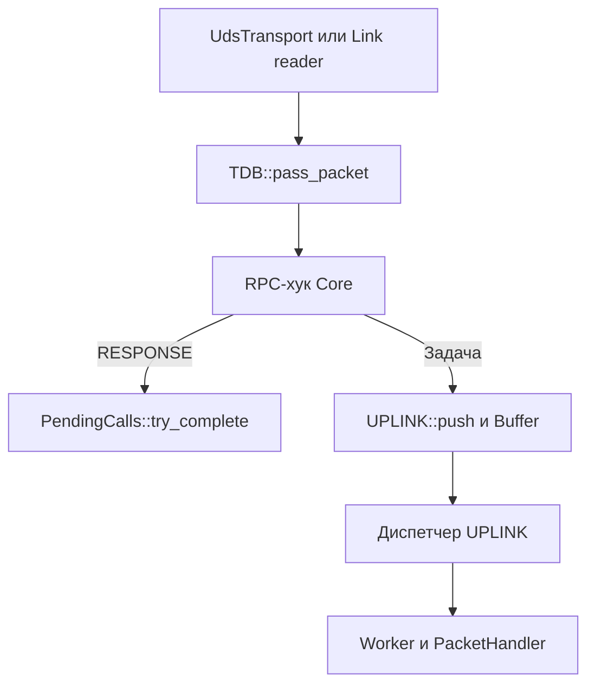

# Loom: правила архитектуры

Это контекст для реализации, а не документация библиотеки.
Источник истины — код. Если код и этот файл расходятся, сначала проверь код и обнови файл.

Используй эти правила как жёсткие ограничения при изменении TDB, транспорта, Cache и LinkManager.

---

## 1. Владение и ответственность

- TDB — композиция `UPLINK` и `OUTLINK`. В TDB нет логики транспорта, Cache или GWP.
- Core владеет RPC-конвертом, реестром ожидающих вызовов и входным хуком. TDB вызывает хук перед передачей кадра в `UPLINK`.
- `UPLINK` владеет:
  - обычным входным `Buffer` и отдельным priority `Buffer` для каждого приоритетного соединения;
  - одной `DistributionStrategy`;
  - пулом общих `Worker`;
  - лениво создаваемыми direct-воркерами по имени модуля;
  - потоком диспетчера.
- Входной `Buffer` — это буфер перегрузки, а не очередь задач воркеров.
- Priority `Buffer` создаётся при первом пакете соединения. Диспетчер обходит эти буферы по кругу перед обычным.
- Единственный потребитель входных буферов — диспетчер `UPLINK`.
- `Worker` не вызывает `Buffer::pop` и не забирает задачи из входных буферов.
- Диспетчер передаёт каждый пакет из `Buffer` ровно одному воркеру по решению `DistributionStrategy` или напрямую выделенному воркеру priority-модуля.
- `Worker` владеет одним слотом задачи, своим потоком, счётчиками и конфигурацией `PacketHandler`/`OutgoingSink`.
- `OUTLINK` владеет обычной и priority исходящей очередью и пулом отправителей.
- `TransportManager` только роутит по `endpoint.type`; сначала пробует `ConnectionCache`.
- `LinkManager` владеет исходящими активными соединениями.
- `ConnectionCache` владеет реестром уже принятых входящих соединений; fd остаётся у транспорта.
- Cache только резолвит `module -> endpoint`.
- `LinkManager` и `ConnectionCache` процесс-глобальные, доступ через `get_link_manager()` и `get_connection_cache()`.

---

## 2. Входной буфер и распределение

- Транспорт вызывает `TDB::pass_packet`. Кадры, оставленные входным хуком, идут через `UPLINK::push` в ограниченный `Buffer`.
- `Buffer` сглаживает всплески и защищает модуль от перегрузки.
- Если `Buffer` полон, `UPLINK::push` отбрасывает пакет и увеличивает счётчик `dropped`.
- Диспетчер использует `Buffer::try_consume`. Сначала он назначает задачу с головы буфера через `Worker::try_submit`, затем освобождает слот буфера.
- `DistributionStrategy` выбирает воркера общего пула.
- `RoundRobinStrategy` — стратегия по умолчанию; другую можно передать в `UPLINK::init` или `TDB::init`.
- Стратегия возвращает индекс свободного воркера или `npos`.
- У воркера один слот задачи: `try_submit` не блокирует и возвращает `false`, если воркер занят или слот заполнен.
- Если свободного воркера нет, пакет остаётся в голове своего буфера. Диспетчер проверяет следующие буферы.
- Воркеры не конкурируют за `Buffer` и не конкурируют за задачи между собой.
- Число воркеров и ёмкость каждого входного буфера настраиваются независимо.
- Диспетчер ждёт на общем `WakeChannel`; производители и освободившиеся воркеры будят его через `notify_one`.
- У каждого воркера своя условная переменная для ожидания задачи.
- Не добавлять неограниченные очереди на воркера: текущая модель — один слот.
- Пакет с `IncomingPacket::priority` попадает в FIFO с ключом `IncomingPacket::connection`. Остальные пакеты идут в обычный `Buffer`.
- У двух соединений одного модуля разные буферы. Диспетчер удаляет буфер после закрытия соединения и выдачи всех принятых пакетов.
- Для priority-модуля диспетчер сначала пробует его выделенный `Worker`.
- Выделенный `Worker` создаётся лениво, пока `direct_workers_.size() < max_direct_workers`.
- Если выделенный воркер недоступен, диспетчер пробует общий пул по обычной стратегии.
- `max_direct_workers == kAutoDirectWorkers` означает «столько же, сколько общих воркеров»; `0` отключает выделенные воркеры.
- Один выделенный воркер обслуживает один модуль; это не меняет модель «один слот на воркера».

---

## 3. Входящий путь



### Транспорт и распределение

- Транспорт использует `parse_header` для определения длины кадра. RPC-семантика принадлежит Core.
- Оба UDS-пути, `UdsTransport::client_loop` и `Link::reader_loop`, передают полный `IncomingPacket` в `TDB::pass_packet`.
- Транспорт передаёт `client_fd = -1`.
- UDS `client_loop` читает несколько кадров с одного принятого fd.
- Принятый fd остаётся у транспорта и закрывается при ошибке, EOF или остановке транспорта.
- UDS-соединение начинается с handshake: LinkManager отправляет имя своего модуля и priority-флаг, `UdsTransport` запоминает их и кладёт имя в `IncomingPacket::client_address`.
- Сразу после handshake `UdsTransport` регистрирует соединение в `ConnectionCache` под именем модуля-отправителя.
- `client_address` нужен для логов, для поиска endpoint'а получателя ответа и для поиска уже открытого входящего соединения в `ConnectionCache`.
- `IncomingPacket::priority` берётся из handshake. Для такого соединения читатель сокета владеет локальной меткой `IngressConnection` и передаёт слабую ссылку на неё рядом с кадром.
- Только диспетчер читает входной `Buffer`.
- Worker не вызывает `Buffer::pop`; он принимает задачу через `try_submit`.
- Worker никогда не вызывает транспорт напрямую.
- Worker возвращает ответ только через `OutgoingSink`.

### Доставка ответа

- Core устанавливает `receive_response` как `TDB::IngressHandler`. Хук возвращает `true` для обработанного `RESPONSE`. Запросы идут в `UPLINK`, воркер десериализует GWP и вызывает `PacketHandler`.
- `REQUEST` и `RESPONSE` несут `reply_to` в RPC-конверте `GWP.data`. Формат `LRP/1` включает четырёхбайтовую метку `4c 52 50 01`, затем `worker_handle` и `call_seq` по 64 бита в big-endian. Остаток конверта — аргументы или результат. `ASYNC_DATA` содержит только аргументы.
- Перед отправкой `loom_call()` регистрирует `PendingCall` в реестре Core. `worker_handle` — числовой дескриптор вызывающего потока, а `call_seq` растёт с каждым его вызовом. Это покрывает воркеры и обычные потоки приложения.
- Получатель запроса переносит `reply_to` в ответ. Обратный маршрут определяется по `IncomingPacket::client_address`.
- На стороне вызывающего модуля `try_complete()` под мьютексом находит запись по `worker_handle` и проверяет `call_seq` и состояние ожидания. При совпадении записывает результат и будит поток через его условную переменную. Просроченные и повторные ответы поглощает тот же хук.
- Тайм-аут использует тот же мьютекс и помечает вызов завершённым. Объект `PendingCall` удаляет запись при выходе из `loom_call()`, в том числе при ошибке отправки.

---

## 4. Исходящий путь

```text
PacketHandler
  -> OutgoingSink
  -> TDB::submit_outgoing
  -> OUTLINK::push (priority или обычная очередь)
  -> отправитель
  -> SendCallback
  -> TransportManager::send_outgoing
  -> ConnectionCache::send (уже принятое входящее соединение)
  -> при промахе:
       resolve_endpoint
       -> send_to(module, ep)
       -> Transport::send_to
       -> UdsTransport::send_to
       -> LinkManager::send
       -> активный Link / новый Link
```

Правила:

- `PacketHandler` формирует `OutgoingPacket.module` из `IncomingPacket::client_address` (имя отправителя, полученное из UDS-handshake).
- `packet_id` берётся из счётчика исходящих кадров текущего процесса. Запрос и ответ выделяют его независимо от `reply_to`.
- `OutgoingPacket.priority` наследуется от входящего запроса; ответ на priority-запрос идёт через priority-очередь OUTLINK.
- `TransportManager` резолвит endpoint:
  1. `ConnectionCache::send(module, frame)`.
  2. При промахе — Cache hit -> использовать endpoint.
  3. Промах Cache -> `server_api::locate(module)`.
  4. Пустой ответ ядра -> ошибка.
  5. `save_endpoint_to_cache(module, address)`.
  6. Повторно прочитать endpoint из Cache.
- Для нового запроса `ConnectionCache` переиспользуется только при совпадении priority-режима; ответы переиспользуются безусловно.
- `TransportManager` не владеет ни пулом соединений, ни `ConnectionCache`; он только вызывает их API.
- UDS-отправка идёт через `LinkManager`.
- Ключ `LinkManager`: `type|address|port`. Priority-режим endpoint'а хранится отдельно и задаёт флаг handshake.
- `LinkManager` переиспользует существующий Link для endpoint.
- При ошибке отправки Link инвалидируется и делается одна попытка переподключения.
- Смена priority инвалидирует Link: handshake отправляется только при открытии, поэтому режим нужно сообщить новым соединением.
- `LinkManager` сейчас поддерживает только `CONNECTION_UDS`.
- `prune_idle()` — заготовка под будущий фоновый поток очистки.
- `close_all()` вызывается при остановке Loom и очищает сохранённые priority-endpoint'ы.

---

## 5. Жизненный цикл

Запуск:

```text
start(module)
  -> ConnectionCache::clear()
  -> LinkManager::set_local_module(module)
  -> server_api::register_module(module, endpoint)
  -> TDB с RPC-хуком Core
  -> TDB::init и TDB::set_handler(loom_packet_handler)
     -> UPLINK::init(workers, queue_capacity, strategy, max_direct_workers)
        -> обычный Buffer
        -> пул Worker
        -> поток диспетчера
     -> OUTLINK::init(senders, queue_capacity)
  -> TransportManager
  -> зарегистрировать UdsTransport
  -> set_tdb (Link reader -> TDB)
  -> TDB::set_sender(TransportManager::send_outgoing)
  -> PendingCalls::start()
  -> TransportManager::start_all()
```

Остановка:

```text
stop()
  -> TransportManager::stop_all()
     -> UdsTransport::stop()
        -> shutdown входящих соединений
        -> join client-loop потоков
        -> close fd
     -> LinkManager::set_incoming_sink(nullptr)
     -> LinkManager::close_all()
  -> PendingCalls::shutdown()
  -> TDB::shutdown()
     -> UPLINK::shutdown()
     -> OUTLINK::shutdown()
  -> уничтожение TransportManager
  -> финальная очистка LinkManager
  -> ConnectionCache::clear()
  -> server_api::unregister_module(module)
  -> g_running = false
```

Правила:

- Сначала перестать принимать новые пакеты, затем дочитывать TDB.
- Link reader'ы нужно остановить до `TDB::shutdown()`, иначе поток может обратиться к уничтоженному TDB.
- `PendingCalls::shutdown()` закрывает приём новых ожиданий и будит текущие с ошибкой. Это делается перед остановкой воркеров.
- Входящие fd закрываются только после join соответствующих client-loop потоков, чтобы `close()` не гонялся с `recv()`.
- Диспетчер останавливается после опустошения `Buffer`, но до воркеров: он должен успеть раздать остаток.
- Воркеры останавливаются после диспетчера: они дочитывают свой слот.
- Уничтожать `TransportManager` только после того, как TDB дочитан.
- Финальная очистка LinkManager и ConnectionCache идёт после TDB и TransportManager.
- `stop()` снимает модуль с регистрации в имитации ядра.

---

## 6. Жёсткие границы

Это реальные способы сломать архитектуру.

- Не заставлять воркеров читать входной `Buffer` или конкурировать за задачи.
- Не превращать входной `Buffer` в очередь задач воркеров.
- Не обходить `DistributionStrategy` при выборе воркера.
- Не добавлять неограниченные очереди на воркера.
- Не блокировать транспорт, пока все воркеры заняты: пакет остаётся в `Buffer` или отбрасывается.
- Не использовать одну общую условную переменную для слотов всех воркеров.
- Не возвращать старую модель, где все воркеры делают `pop` из общей очереди.
- Транспорт использует заголовок GWP только для чтения границ кадра.
- Не резолвить `module -> endpoint` в транспорте.
- Не передавать fd входящего соединения в TDB; `client_fd` всегда `-1`.
- Не отдавать fd бизнес-логике: ответ может идти по принятому fd только через `ConnectionCache`.
- Не закрывать принятый fd после первого кадра.
- Не считать, что Cache всегда заполнен; при промахе обязателен запрос к ядру.
- Не менять порядок остановки.
- Не класть `module_name`, `endpoint` или `fd` в GWP.
- Хранить `reply_to` в RPC-конверте внутри `data`. В RPC-реестре использовать `worker_handle` и `call_seq`.
- Обрабатывать `RESPONSE` на входе в TDB до `Buffer`. Хук завершает ожидание, а пользовательские методы выполняются в `PacketHandler` воркера.
- Не помещать бизнес-логику в Worker; использовать `PacketHandler`.
- Не включать старую стратегию, которая выбирает воркера в обход диспетчера.
- Не помещать `LinkManager` или `ConnectionCache` внутрь TDB, Worker, OUTLINK или TransportManager.
- Проверять головы priority-буферов перед назначением обычной задачи.
- Не создавать выделенный Worker сверх `max_direct_workers`.
- Не отправлять ответ на priority-запрос через обычную очередь OUTLINK.

---

## 7. Текущие ограничения

- `DistributionStrategy` по умолчанию — только round-robin среди свободных воркеров; priority-путь использует её как fallback.
- Нет тонких стратегий по загрузке; привязка к воркеру есть только у direct-модулей.
- У воркера один слот; отдельной очереди задач у него нет.
- При полном входном `Buffer` пакеты отбрасываются; обратного давления нет.
- Диспетчер ждёт с таймаутом 1 мс; отдельного событийного режима нет.
- Нет метрик задержки диспетчеризации и загрузки воркеров, только счётчики.
- `server_api::locate` — файловая имитация ядра, а не реальный запрос.
- Имитация ядра не имеет heartbeat, TTL и авторизации.
- UDS-handshake передаёт имя модуля и priority-флаг, но не проверяет имя и не аутентифицирует.
- Значения `int`, `double`, `float`, `bool`, `string`, `void` кодируются в формате хоста. Метаданные `reply_to` используют big-endian и версию `LRP/1`. Синхронный RPC требует поддержку этой версии у обоих модулей.
- `loom_call` синхронный. Вложенный вызов занимает воркер на время ожидания. Готовый ответ доставляется вне пула.
- `module_send` — это вызов метода `message` с одним строковым аргументом, а не произвольный payload.
- `LinkManager` поддерживает только UDS.
- Фоновый поток очистки для `prune_idle()` и `ConnectionCache` не запущен.
- Нет лимита размера пула соединений и метрик.
- Входящие соединения обслуживаются потоком на соединение; epoll пока нет.
- `worker/pool.*` и `worker/rpc_manager.*` — неучаствующие заготовки.

---

## 8. Карта файлов

| Путь | Роль |
|---|---|
| `src/core/loom.cpp` | Жизненный цикл, сборка компонентов, PacketHandler, `loom_call` |
| `src/core/rpc_codec.*` | RPC-конверт с `reply_to`, кодек аргументов и результата |
| `src/core/rpc_state.*` | Входной хук Core, реестр ожиданий и проверка `call_seq` |
| `src/gateway/TDB/tdb.*` | Входной хук перед UPLINK, композиция UPLINK и OUTLINK |
| `src/gateway/TDB/uplink/uplink.*` | Обычный Buffer, priority-буферы соединений, диспетчер и пул воркеров |
| `src/gateway/TDB/strategy/strategy.*` | `DistributionStrategy`, `RoundRobinStrategy` |
| `src/gateway/TDB/worker/worker.*` | Один слот задачи, GWP-разбор, `PacketHandler` |
| `src/gateway/TDB/outlink/outlink.*` | Общая исходящая очередь + пул отправителей |
| `src/gateway/TDB/common/wake_channel.hpp` | Мьютекс и условная переменная диспетчера |
| `src/gateway/TDB/buffer/buffer.*` | MPMC `RingBuffer<T>`, структуры пакетов |
| `src/transport/transport.h` | Контракт транспорта |
| `src/transport/transport_manager.*` | Роутинг и резолв через Cache/ядро |
| `src/transport/local/uds_transport.*` | UDS: `accept`, `send`, `client_loop` |
| `src/transport/local/uds.*` | Низкоуровневые UDS-функции |
| `src/transport/link.hpp/.cpp` | `Link` (duplex) и `LinkManager` |
| `src/transport/connection_cache.hpp/.cpp` | `InboundConnection` и `ConnectionCache` |
| `src/transport/handshake.hpp` | UDS-handshake с именем модуля и priority-флагом |
| `src/discovery/cache.*` | `module -> endpoint` |
| `src/core/server_core_api.*` | Имитация ядра: файловый реестр `module -> endpoint/priority` |
| `src/protocol/gwp.*` | GWP-сериализация |
| `brutal_tester/tests/test_tdb.cpp` | Тесты Buffer, диспетчера, стратегии, воркеров, priority-воркеров |
| `brutal_tester/tests/test_transport.cpp` | Тесты транспорта, LinkManager и переиспользования входящих соединений |
| `brutal_tester/tests/test_connect.cpp` | Тесты резолва, реестра имитации ядра и handshake |
| `brutal_tester/tests/test_rpc.cpp` | Сквозной тест двух модулей и тест ответа при занятом воркере с отбрасыванием запоздалого `call_seq` |
| `examples/calc_server.cpp` | Пример модуля-сервера |
| `examples/calc_client.cpp` | Пример модуля-клиента |

---

## 9. Чек-лист изменений

1. Сначала смотреть фактический код.
2. Сохранять владение: Buffer и диспетчер принадлежат UPLINK, воркеры не читают Buffer.
3. Сохранять правило: только `DistributionStrategy` выбирает воркера.
4. Сохранять один слот на воркера; не добавлять неограниченные очереди.
5. Сохранять отправку UDS через `LinkManager`, но сначала пробовать `ConnectionCache`.
6. Сохранять резолв при промахе Cache в `TransportManager`.
7. Проверять priority-буферы по кругу перед обычным. В OUTLINK выбирать priority-очередь первой.
8. Обновлять `test_tdb.cpp` / `test_transport.cpp` / `test_connect.cpp` / `test_rpc.cpp` при изменении поведения.
9. Запускать обычные тесты, ASan/UBSan и TSan.
10. Будущие задачи писать в `TODO.md`, а не в этот файл.
11. При изменении публичного API обновлять `README.md` и примеры в `examples/`.
